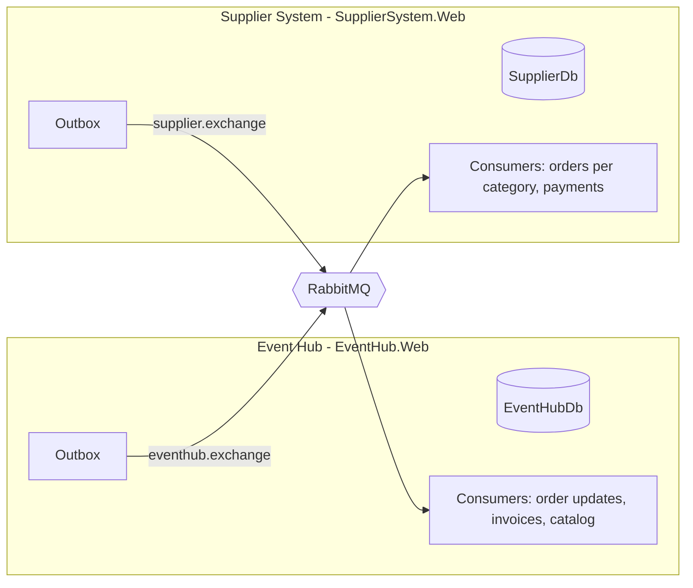

# Event Hub + Supplier System: project guide

Handover document for the team: what the project is, what is done, how to run it locally, how to test everything, how to explain it, and what is left.

Status at the time of writing (2026-11-20): the core of the brief works end to end. See [section 7](#7-what-is-left) for the open items.

---

## 1. What the project is

Two independent ASP.NET Core MVC applications (.NET 9), each with its own SQL Server database. They never share a database. The only link between them is RabbitMQ messages.

| App | Project | Port | Users |
|---|---|---|---|
| **Event Hub** | `EventHub.Web` | 5001 | Organizers plan events and order supplies. Clients buy tickets. An admin oversees the platform. |
| **Supplier System** | `SupplierSystem.Web` | 5002 | Several suppliers, each selling ONE category (catering, decoration, sound and lighting). Catalog, stock, incoming orders, invoices. |

Shared libraries: `EventHub.Contracts` (message records, categories, queue names, routing) and `EventHub.Messaging` (RabbitMQ connection, publisher, outbox, consumer base class). `EventHub.Tests` is the xUnit project (still the empty template, see section 7).



### Messages (the only link between the apps)

| Direction | Message | When |
|---|---|---|
| Event Hub to Supplier | `SupplyOrderPlaced`, `OrderCancelled` | Organizer orders / cancels (routing key ends with the category, for example `order.placed.catering`) |
| Event Hub to Supplier | `PaymentCompleted` | Organizer pays an invoice |
| Supplier to Event Hub | `CatalogPublished`, `ItemAvailabilityChanged` | Catalog or stock changes |
| Supplier to Event Hub | `OrderStatusChanged`, `OrderRejected` | Accepted, Preparing, Dispatched, Delivered, or rejected |
| Supplier to Event Hub | `InvoiceIssued` | Supplier invoices a delivered order |

Queues: one durable order queue per category (`supplier.orders.catering`, `.decoration`, `.sound`), `supplier.payments`, `eventhub.order-updates`, `eventhub.invoices`, `eventhub.catalog`. Each has a retry queue and a dead-letter queue.

Client ticket sales stay inside the Event Hub. They do not use RabbitMQ. The only organizer/supplier link is orders, status, invoices and payments.

### Roles and demo accounts

Event Hub (http://localhost:5001):

| Role | Email | Password | Can do |
|---|---|---|---|
| Organizer | `organizer@eventhub.local` | `Organizer123!` | Events, needs, AI suggestions, ticket types, orders, invoices |
| Client | `client@eventhub.local` | `Client123!` | Browse published events, buy tickets (fake payment), My tickets |
| Admin | `admin@eventhub.local` | `Admin123!` | Overview charts, exports, users, all events/orders/tickets, message monitor |

Anyone can also register as a client or organizer on the Register page.

Supplier System (http://localhost:5002), password `Admin123!` for all:

| Email | Role | Supplier |
|---|---|---|
| `admin@supplier.local` | Platform admin (read-only, sees all suppliers) | all |
| `manager.golden@supplier.local` | Manager | Golden Fork Catering |
| `manager.royal@supplier.local` | Manager | Royal Feast Catering |
| `manager.bloom@supplier.local` | Manager | Bloom & Co Decoration |
| `manager.soundwave@supplier.local` | Manager | SoundWave Pro |
| `staff.golden@supplier.local` | Staff (processes orders only, cannot edit the catalog) | Golden Fork |

---

## 2. What is done

Legend: **Verified** = run and checked by hand. **Written** = implemented, builds, but not yet checked in a full test run.

| Area | Status | Notes |
|---|---|---|
| Two apps, separate databases, RabbitMQ link | Verified | |
| Shared contracts, category-aware routing, topology | Verified | |
| Reliable messaging: outbox, publisher confirms, manual acks, retry queue, DLQ, idempotent consumers, message log | Verified (basic flow) | Failure scenarios in test section F |
| Authentication, roles, lockout, per-app cookies | Verified | |
| Event Hub: events, needs checklist, edit, plan, complete, cancel | Verified | Cancelling an event cancels open orders and refunds ticket purchases in one transaction |
| Event Hub: supplier catalog copy, place order, track status, cancel order | Verified | |
| Supplier System: catalog, stock, reserve on accept, deduct on dispatch, release on cancel | Verified | |
| Supplier System: order lifecycle, per-supplier access control | Verified | |
| Clients: Discover page, ticket types, publish, checkout with fake gateway, My tickets with QR, refunds, sold-out protection | Verified | Optimistic concurrency (row version) stops overselling |
| Admin area: orders list and cancel override | Verified | |
| Admin area: Overview with 6 Chart.js charts, Excel and PDF export, users enable/disable, all events, ticket sales, message monitor | Written | Test in section D |
| Invoices and payment between organizer and supplier | Verified | Supplier issues invoice after delivery, organizer pays, supplier sees Paid |
| SignalR live updates in both apps (toast + auto refresh) | Verified | |
| AI suggestion of event needs (Gemini or Claude API, rules as fallback) | Verified | Needs an API key, see section 3 |
| Clickable table rows | Verified | |
| Docker for the infrastructure (RabbitMQ, SQL Server) | Verified | |

### Brief coverage

| Requirement | Where |
|---|---|
| Two ASP.NET Core MVC apps with separate EF Core databases | `EventHub.Web`, `SupplierSystem.Web` |
| Service and repository layers | `Services/`, `Repositories/` in both apps |
| Reliable messaging (RabbitMQ) | `EventHub.Messaging`, `EventHub.Contracts` |
| SignalR | `Hubs/LiveHub.cs`, `wwwroot/js/live.js`, notifier services |
| Reports with Chart.js, PDF and Excel export | Event Hub `AdminController`, `Views/Admin/Index.cshtml`, `Services/ReportExporter.cs` (supplier-side reports not built yet) |
| AI API | `EventHub.Web/Services/Ai/EventAdvisor.cs` |
| Payment gateway | `IPaymentGateway` / `FakePaymentGateway` (tickets and invoices) |
| Roles and authorization | Identity roles, `[Authorize]`, supplier scoping by claim |

Check with the doctor that two peer systems plus client and admin roles satisfy the wording "Client App / Admin & Reporting App". The admin and client functions live inside the Event Hub app, not as separate applications.

---

## 3. Run it locally

### Prerequisites
- .NET 9 SDK
- Docker Desktop (running)
- EF Core tool: `dotnet tool install --global dotnet-ef`
- Optional: a free Gemini API key for the AI feature (https://aistudio.google.com)

### First run
All commands from the repository root (`EventHub/`), in PowerShell.

```powershell
docker compose up -d        # RabbitMQ + SQL Server, wait about 30 seconds
dotnet build
```

Migrations are already in the repository, and the apps apply them on startup (they retry while SQL Server is still starting). You do not need to run `dotnet ef` unless you change a model.

Start the **Supplier System first** (it publishes the supplier catalogs when it seeds), each in its own terminal:

```powershell
dotnet run --project SupplierSystem.Web --launch-profile http
```
```powershell
# optional, enables the real AI suggestions
$env:Ai__ApiKey = "your-key"
dotnet run --project EventHub.Web --launch-profile http
```

Then open http://localhost:5001 and http://localhost:5002. RabbitMQ management UI: http://localhost:15672 (`eventhub` / `eventhub_pw`).

The seeders create the demo accounts, 4 suppliers with products and stock, demo events and orders, and 6 published events with tickets.

### Never commit a key
`Ai__ApiKey` is read from the environment. Do not put it in `appsettings.json`. Provider and model are in `appsettings.json` under `Ai` (`Provider`: `Gemini` or `Anthropic`; override with `Ai__Provider`, `Ai__Model`). Without a key the advisor falls back to simple built-in rules and says so on the page.

### Start over (clean databases and queues)
```powershell
docker compose down -v
docker compose up -d
```
Wait for SQL Server, then run both apps again; they recreate and seed everything.

### Changing a model
```powershell
dotnet ef migrations add <Name> --project EventHub.Web --output-dir Data/Migrations
dotnet ef migrations add <Name> --project SupplierSystem.Web --output-dir Data/Migrations
```
Migration names must be unique per project.

### Troubleshooting

| Symptom | Cause and fix |
|---|---|
| Supplier orders stay empty | RabbitMQ not reachable. `docker compose up -d`, restart the apps (they reconnect on their own). Check `<App>/logs/*.log` for `5672` errors |
| SQL "pre-login handshake" on first start | SQL Server container still starting. The apps retry for about a minute |
| RabbitMQ container exits with `.erlang.cookie` error | Run `docker compose` from the repo folder, and use the compose file as is (no RabbitMQ volume) |
| `docker compose` says "no configuration file provided" | You are not in the repo root |
| Page looks old or a row is not clickable | Hard refresh (Ctrl+F5); CSS and JS are cached |
| `The name 'X' is used by an existing migration` | Choose another migration name |
| Suggest needs shows "Built-in rules" | No key, or the AI call failed. Look for `AI suggestion failed` / `Gemini returned` in `EventHub.Web/logs/` |
| Port already in use | Another run is still open. Stop it, or change the port in `Properties/launchSettings.json` |

Logs are written to `EventHub.Web/logs/` and `SupplierSystem.Web/logs/` (Serilog, ignored by git).

---

## 4. How to test everything

Use two browser windows or profiles, one per app, because the apps use different cookies. Reset the data (section 3) before a full run if earlier tests changed it.

### A. Accounts and access
1. Event Hub: sign in as each of the three roles. Organizer lands on My events, client on Discover, admin on the Admin overview.
2. Register a new client and a new organizer.
3. Type a wrong password 5 times: the account locks for 5 minutes.
4. As a client, open `/Events` or `/Admin`: access denied. As an organizer, open `/Admin`: access denied.
5. Supplier System: sign in as `manager.golden@supplier.local`: you see only Golden Fork orders and products. `admin@supplier.local` sees all and has no action buttons.

### B. Organizer: events and needs
1. New event: name, type, venue, date, guests, description. Save.
2. Add needs (catering, decoration, sound). A category can be added once per event.
3. **✨ Suggest needs**: with a key the badge says "Suggested by AI". Click "Add to this event" on one suggestion.
4. Edit the event. Mark it Planned, then Completed on another event.

### C. Orders and the supplier round trip
1. Event page, a need, **Find a supplier**, choose a supplier, enter quantities, send. Status Pending.
2. Supplier System, matching manager: the order appears as Received (live toast if the page is open). Open it.
3. **Accept**: stock is reserved (Catalog & stock shows Reserved). Event Hub status becomes Accepted.
4. Start preparing, Dispatch (stock on hand drops, reserved returns to 0), Mark delivered. The Event Hub follows each step live.
5. **Reject** another order (reason): Event Hub shows Rejected with the reason.
6. **Stock failure**: order more than the stock; Accept fails with "Not enough stock", order stays Received.
7. **Cancel** a Pending and an Accepted order from the Event Hub: the supplier sees Cancelled and reserved stock is released.
8. **Cancel the whole event**: open orders are cancelled and ticket purchases refunded.
9. Only one active order per category per event; a second one is refused.

### D. Admin area (Event Hub, `admin@eventhub.local`)
1. **Overview**: six charts and the stat tiles show data. **Export Excel** downloads a workbook with Summary, Events, Supply orders, Ticket sales. **Export PDF** downloads the report.
2. **Users**: disable `client@eventhub.local`, then try to sign in as that client (locked). Enable again. Admin accounts have no button.
3. **Events / Supply orders / Ticket sales**: read-only lists across all organizers and clients.
4. **Supply orders**: cancel a Pending order with a reason. The supplier sees "Cancelled by administrator: ...".
5. **Message monitor**: filter by status. After the tests above you see Published and Consumed entries; outbox counters are 0 when everything has been sent.

### E. Clients and tickets
1. Organizer: open an event, add ticket types (price, quantity), **Publish**.
2. Client: Discover, open the event, buy tickets. Use card `4242 4242 4242 4242`, expiry in the future, any CVV. The ticket appears in My tickets with a QR code.
3. Card ending `0000` is declined, `9999` has insufficient funds. No ticket is issued and the reserved quantity is released.
4. Buy until sold out: the button is disabled and shows Sold out.
5. Organizer: Cancel the event. Client My tickets shows the purchases as Refunded and tickets as void.

### F. Invoices and payment
1. Supplier (for example Royal Feast), a Delivered order: **Issue invoice**. The Invoices page lists it as Awaiting payment.
2. Event Hub, Invoices: the invoice appears as Due (live toast). Click **Pay**, enter a test card. Decline cards `...0000` / `...9999` leave it Due.
3. After payment: the Event Hub shows Paid with a payment reference, and the Supplier System shows Paid.

### G. Live updates (SignalR)
Open the Event Hub Orders list and the Supplier orders page side by side. Accept/advance in the supplier: a toast and an automatic refresh appear in the Event Hub. Place an order in the Event Hub: the supplier gets "New order received".

### H. Reliability (the part the doctor may probe)
1. **Broker down**: `docker stop eventhub-rabbitmq`, place an order in the Event Hub. It is saved (outbox row waiting, shown on the admin Message monitor). `docker start eventhub-rabbitmq`: the order arrives at the supplier within seconds.
2. **Consumer down**: stop the Supplier System, place an order, start it again: the order is delivered from the durable queue.
3. **Duplicate delivery**: the same message processed twice changes nothing (ProcessedMessages, unique keys). Look at `ProcessedMessages` in the database.
4. **Poison message**: in the RabbitMQ UI publish an invalid message to `eventhub.exchange` with routing key `order.placed.catering`. It is retried 3 times (retry queue) and ends in `supplier.orders.catering.dlq`, with a Failed or DeadLettered row in the message log.
5. Order state machine: status can only move forward; late or repeated status messages are ignored.

---

## 5. How to explain it (what the doctor will ask)

- **Why two apps and RabbitMQ?** Independent systems with their own data. If the supplier app is down, the Event Hub keeps working and orders wait in a durable queue. Asynchronous, loosely coupled.
- **Outbox pattern.** A business change and the outgoing message are saved in ONE database transaction (`OutboxMessages`). A background publisher sends them to RabbitMQ and marks them sent. So a crash cannot leave data saved with the message lost, or the reverse.
- **Publisher confirms and manual acks.** The publisher waits for the broker to confirm. Consumers acknowledge only after the work is saved, so a crash re-delivers the message.
- **Idempotent consumers.** Delivery is at-least-once, so duplicates can happen. Each consumer records processed message ids (`ProcessedMessages`) and domain rules ignore repeats.
- **Retry and dead letters.** A failing message goes to a retry queue (delayed), then back to the main queue. After the maximum attempts it lands in the `.dlq` queue for a human, and the message log shows it.
- **Routing.** Topic exchanges. Order messages carry the category in the routing key, so each supplier category has its own queue and consumer.
- **Layering.** Controllers are thin, services hold the business rules, repositories hold EF queries. Entities enforce their own state transitions (an order cannot go from Received to Delivered).
- **Concurrency.** Ticket sales use a row version on the ticket type, so two buyers cannot take the last ticket. Purchases are reserve, then charge, then issue, with compensation (release) if payment fails.
- **Stock.** Accept reserves, dispatch deducts, cancel releases, so a product is never promised twice.
- **Security.** Identity with hashed passwords and lockout, role-based authorization, supplier staff locked to their own supplier by a claim (never by URL or form value), anti-forgery tokens, per-app cookie names.
- **SignalR.** One hub per app; each user (or supplier) joins a group, and services push through a small notifier interface after saving. A failed push never fails the business operation.
- **AI.** An advisor behind an interface calls a language model, validates the JSON answer (only real categories are accepted), has a time limit, and falls back to rules so the feature always works. The organizer decides what to add.
- **Payment gateway.** Behind `IPaymentGateway`; a real provider would be plugged in without touching the services. Card data is never stored or logged.

---

## 6. Repository layout

```
EventHub.Contracts/     message records, SupplyCategories, Topology (queues/keys), MessageRoutes, DemoData
EventHub.Messaging/     RabbitMQ connection, publisher, OutboxPublisher, BaseConsumer, TopologyDeclarer
EventHub.Web/           Event Hub app
  Controllers/ Services/ Repositories/ Models/ ViewModels/ Views/ Hubs/ Messaging/ Data/ (DbContext, seeder, Migrations)
SupplierSystem.Web/     Supplier System app (same structure)
EventHub.Tests/         xUnit (template only)
docker-compose.yml      RabbitMQ + SQL Server
docs/PROJECT_GUIDE.md   this file
```

### Adding a new message
1. Add the record to `EventHub.Contracts/Messages.cs` and its route to `MessageRoutes.cs`.
2. If it needs a new queue, add the name and binding in `Topology.cs`.
3. Publisher: `IOutbox.Enqueue(message)` in the service, before the single `SaveChanges`.
4. Consumer: a class deriving from `BaseConsumer` (see `Messaging/Consumers.cs`), registered with `AddConsumer<T>()`. Make the handler idempotent.

---

## 7. What is left

Ordered by value for the grade.

### Must do
1. **Supplier System reports**: Chart.js dashboard (orders per month, revenue per product, acceptance rate) with PDF and Excel export, as the Event Hub admin has.
2. **Manual orders in the Supplier System**, so it is useful on its own (a supplier records a phone order; `OrderSource.Manual` already exists in the model, and manual orders skip the notifications).
3. **Supplier admin screens**: create suppliers and staff accounts (today they are seeded).
4. **Automated tests** (`EventHub.Tests` is still the template): state transitions on `SupplyOrder`, stock reserve/release, `MessageRoutes`, idempotency, ticket purchase with a fake gateway, and one integration test of outbox publishing.
5. **Finish the manual test run** in section 4 (sections C8, D, E, H are the least tested) and fix what you find.

### Should do
6. **Guest list UI** in the Event Hub (the `Guest` model exists, there are no screens).
7. **Docker for the apps**: add the two apps to `docker-compose.yml` (Dockerfiles, connection strings and RabbitMQ host as environment variables) so `docker compose up` runs everything.
8. **Ticket check-in**: `Ticket.UsedAtUtc` exists; add a scan or validate screen that reads the QR code.
9. **Invoice extras**: overdue reminders, show invoices on the admin pages and reports, supplier invoice PDF.

### Nice to have / known limitations
- Admin cannot manage suppliers or catalogs (by design, that belongs to the Supplier System).
- A disabled user who is already signed in keeps the session for up to about 30 minutes; sign-in is blocked immediately.
- Two simultaneous clicks on Pay could both reach the fake gateway; only one invoice payment is saved (row version), but a real gateway would need an idempotency key.
- Emails are not sent (no SMTP); notifications are in-app only.
- HTTPS and production secrets are not configured; connection strings in `appsettings.json` are demo defaults matching `docker-compose.yml`.

### Suggested split between teammates
| Person | Work |
|---|---|
| A | Supplier reports and charts (item 1), manual orders (item 2) |
| B | Supplier admin screens (item 3), guest list UI (item 6) |
| C | Tests (item 4), Docker for the apps (item 7) |
| Everyone | Section 4 test run, rehearsing section 5 |

Work on branches (`feature/<name>`), small pull requests, and rebuild plus run the section 4 smoke tests before merging.
